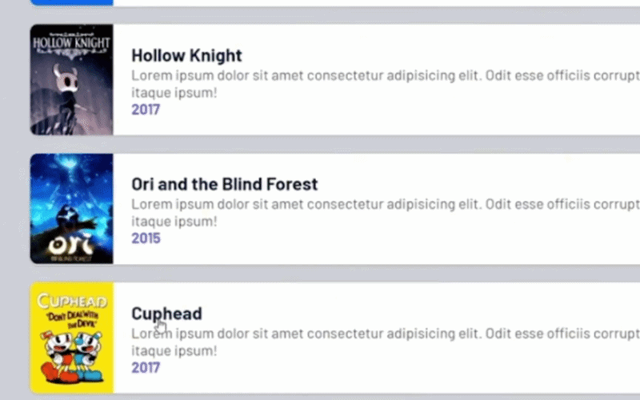
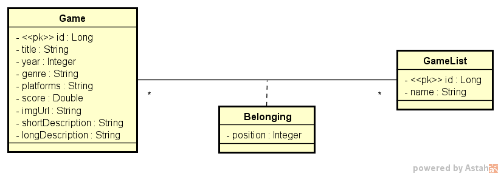

# DSList 🎮

## Sobre o projeto

Backend RESTful para gerenciar jogos e listas personalizadas, desenvolvido com Java 25 e Spring Boot 4 como projeto de portfólio.



*Reordenando jogos de uma lista pelo endpoint POST /lists/{id}/move.*


## Como executar

### Pré-requisitos
- Java 25
- Git
- Docker com Compose (apenas para a opção com PostgreSQL)

### Opção 1: H2 (mais simples)

O perfil padrão é o `test`, que usa o banco H2 em memória. Não é preciso configurar nada.

```bash
git clone https://github.com/isaacpatrocinio/dslist.git
cd dslist
./mvnw spring-boot:run
```

Acesse `http://localhost:8080/games`. Para parar, pressione `Ctrl + C`.

### Opção 2: PostgreSQL com Docker

Suba o banco:

```bash
docker compose up -d
```

Rode a aplicação com o perfil `dev`. Substitua os valores pelos mesmos que você definiu no `.env`. A porta `5432` é a padrão do PostgreSQL; use outra apenas se ela já estiver em uso no seu computador, ajustando também o `DB_PORT` no `.env`:

```bash
APP_PROFILE=dev DB_USER=seu_usuario DB_PASSWORD=sua_senha DB_NAME=seu_banco DB_PORT=5432 ./mvnw spring-boot:run
```

Acesse `http://localhost:8080/games`.

Para parar a aplicação, pressione `Ctrl + C`. Para parar o banco, use:

```bash
docker compose down
```


## Tecnologias
- Java 25
- Spring Boot 4
- Hibernate / JPA (ORM)
- Maven
- Docker
- H2 Database
- PostgreSQL

## Endpoints


### Obter todos os jogos
* **URL: `/games`**
* **Método: `GET`**
* **Resposta: (200 OK)**
 
```json
[
    {
        "id": 1,
        "title": "Mass Effect Trilogy",
        "year": 2012,
        "imgUrl": "https://raw.githubusercontent.com/devsuperior/java-spring-dslist/main/resources/1.png",
        "shortDescription": "Lorem ipsum dolor sit amet consectetur adipisicing elit. Odit esse officiis corrupti unde repellat non quibusdam! Id nihil itaque ipsum!"
    },
    {
        "id": 2,
        "title": "Red Dead Redemption 2",
        "year": 2018,
        "imgUrl": "https://raw.githubusercontent.com/devsuperior/java-spring-dslist/main/resources/2.png",
        "shortDescription": "Lorem ipsum dolor sit amet consectetur adipisicing elit. Odit esse officiis corrupti unde repellat non quibusdam! Id nihil itaque ipsum!"
    },
    {
        "id": 3,
        "title": "The Witcher 3: Wild Hunt",
        "year": 2014,
        "imgUrl": "https://raw.githubusercontent.com/devsuperior/java-spring-dslist/main/resources/3.png",
        "shortDescription": "Lorem ipsum dolor sit amet consectetur adipisicing elit. Odit esse officiis corrupti unde repellat non quibusdam! Id nihil itaque ipsum!"
    },
    {
        "id": 4,
        "title": "Sekiro: Shadows Die Twice",
        "year": 2019,
        "imgUrl": "https://raw.githubusercontent.com/devsuperior/java-spring-dslist/main/resources/4.png",
        "shortDescription": "Lorem ipsum dolor sit amet consectetur adipisicing elit. Odit esse officiis corrupti unde repellat non quibusdam! Id nihil itaque ipsum!"
    },
    {
        "id": 5,
        "title": "Ghost of Tsushima",
        "year": 2012,
        "imgUrl": "https://raw.githubusercontent.com/devsuperior/java-spring-dslist/main/resources/5.png",
        "shortDescription": "Lorem ipsum dolor sit amet consectetur adipisicing elit. Odit esse officiis corrupti unde repellat non quibusdam! Id nihil itaque ipsum!"
    },
    {
        "id": 6,
        "title": "Super Mario World",
        "year": 1990,
        "imgUrl": "https://raw.githubusercontent.com/devsuperior/java-spring-dslist/main/resources/6.png",
        "shortDescription": "Lorem ipsum dolor sit amet consectetur adipisicing elit. Odit esse officiis corrupti unde repellat non quibusdam! Id nihil itaque ipsum!"
    },
    {
        "id": 7,
        "title": "Hollow Knight",
        "year": 2017,
        "imgUrl": "https://raw.githubusercontent.com/devsuperior/java-spring-dslist/main/resources/7.png",
        "shortDescription": "Lorem ipsum dolor sit amet consectetur adipisicing elit. Odit esse officiis corrupti unde repellat non quibusdam! Id nihil itaque ipsum!"
    },
    {
        "id": 8,
        "title": "Ori and the Blind Forest",
        "year": 2015,
        "imgUrl": "https://raw.githubusercontent.com/devsuperior/java-spring-dslist/main/resources/8.png",
        "shortDescription": "Lorem ipsum dolor sit amet consectetur adipisicing elit. Odit esse officiis corrupti unde repellat non quibusdam! Id nihil itaque ipsum!"
    },
    {
        "id": 9,
        "title": "Cuphead",
        "year": 2017,
        "imgUrl": "https://raw.githubusercontent.com/devsuperior/java-spring-dslist/main/resources/9.png",
        "shortDescription": "Lorem ipsum dolor sit amet consectetur adipisicing elit. Odit esse officiis corrupti unde repellat non quibusdam! Id nihil itaque ipsum!"
    },
    {
        "id": 10,
        "title": "Sonic CD",
        "year": 1993,
        "imgUrl": "https://raw.githubusercontent.com/devsuperior/java-spring-dslist/main/resources/10.png",
        "shortDescription": "Lorem ipsum dolor sit amet consectetur adipisicing elit. Odit esse officiis corrupti unde repellat non quibusdam! Id nihil itaque ipsum!"
    }
]
```
### Obter jogo por id
* **URL: `/games/{id}`**
* **Método: `GET`**
* **Resposta: (200 OK)**

```json
{
    "id": 5,
    "title": "Ghost of Tsushima",
    "year": 2012,
    "genre": "Role-playing (RPG), Adventure",
    "platforms": "Xbox, Playstation, PC",
    "score": 4.6,
    "imgUrl": "https://raw.githubusercontent.com/devsuperior/java-spring-dslist/main/resources/5.png",
    "shortDescription": "Lorem ipsum dolor sit amet consectetur adipisicing elit. Odit esse officiis corrupti unde repellat non quibusdam! Id nihil itaque ipsum!",
    "longDescription": "Lorem ipsum dolor sit amet consectetur adipisicing elit. Delectus dolorum illum placeat eligendi, quis maiores veniam. Incidunt dolorum, nisi deleniti dicta odit voluptatem nam provident temporibus reprehenderit blanditiis consectetur tenetur. Dignissimos blanditiis quod corporis iste, aliquid perspiciatis architecto quasi tempore ipsam voluptates ea ad distinctio, sapiente qui, amet quidem culpa."
}
```

### Obter listas
* **URL: `/lists`**
* **Método: `GET`**
* **Resposta: (200 OK)**

```json
[
    {
        "id": 1,
        "name": "Aventura e RPG"
    },
    {
        "id": 2,
        "name": "Jogos de plataforma"
    }
]
```

### Obter jogos de uma lista
* **URL: `/lists/{id}/games`**
* **Método: `GET`**
* **Resposta: (200 OK)**

```json
[
    {
        "id": 6,
        "title": "Super Mario World",
        "year": 1990,
        "imgUrl": "https://raw.githubusercontent.com/devsuperior/java-spring-dslist/main/resources/6.png",
        "shortDescription": "Lorem ipsum dolor sit amet consectetur adipisicing elit. Odit esse officiis corrupti unde repellat non quibusdam! Id nihil itaque ipsum!"
    },
    {
        "id": 7,
        "title": "Hollow Knight",
        "year": 2017,
        "imgUrl": "https://raw.githubusercontent.com/devsuperior/java-spring-dslist/main/resources/7.png",
        "shortDescription": "Lorem ipsum dolor sit amet consectetur adipisicing elit. Odit esse officiis corrupti unde repellat non quibusdam! Id nihil itaque ipsum!"
    },
    {
        "id": 8,
        "title": "Ori and the Blind Forest",
        "year": 2015,
        "imgUrl": "https://raw.githubusercontent.com/devsuperior/java-spring-dslist/main/resources/8.png",
        "shortDescription": "Lorem ipsum dolor sit amet consectetur adipisicing elit. Odit esse officiis corrupti unde repellat non quibusdam! Id nihil itaque ipsum!"
    },
    {
        "id": 9,
        "title": "Cuphead",
        "year": 2017,
        "imgUrl": "https://raw.githubusercontent.com/devsuperior/java-spring-dslist/main/resources/9.png",
        "shortDescription": "Lorem ipsum dolor sit amet consectetur adipisicing elit. Odit esse officiis corrupti unde repellat non quibusdam! Id nihil itaque ipsum!"
    },
    {
        "id": 10,
        "title": "Sonic CD",
        "year": 1993,
        "imgUrl": "https://raw.githubusercontent.com/devsuperior/java-spring-dslist/main/resources/10.png",
        "shortDescription": "Lorem ipsum dolor sit amet consectetur adipisicing elit. Odit esse officiis corrupti unde repellat non quibusdam! Id nihil itaque ipsum!"
    }
]
```

### Mover um jogo da posição na lista (Demonstração no topo do README)
\* OBS: Lista inicia na posição 0

* **URL: `/lists/{id}/move`**
* **Método: `POST`**
* **Corpo da requisição (Body):**

```json
{
    "sourceIndex" : 3,
    "destinationIndex" : 1
}
```

## Modelo Conceitual

